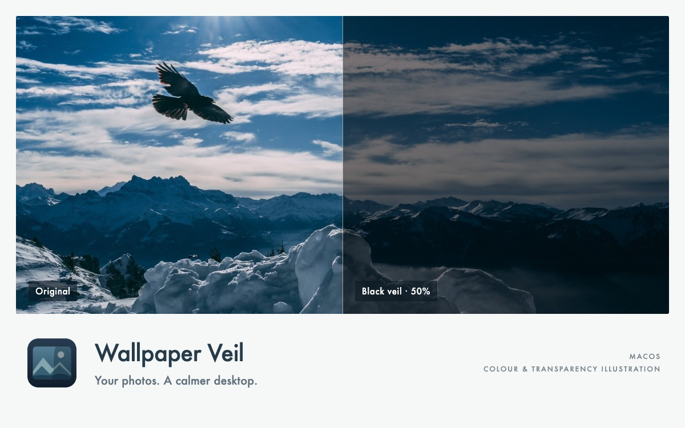
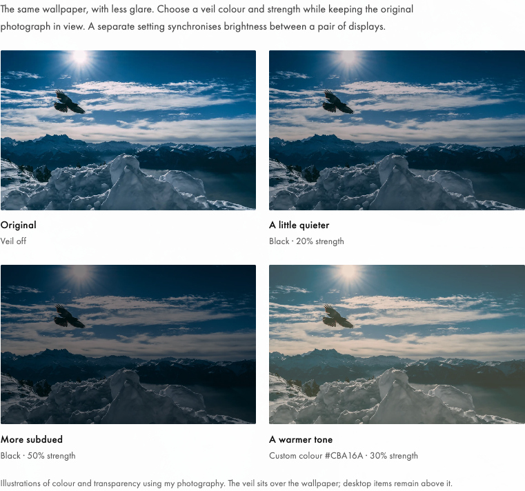
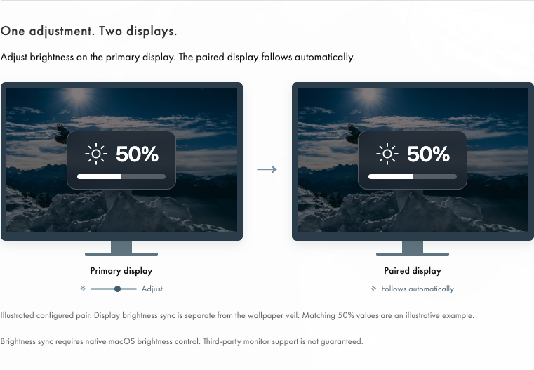
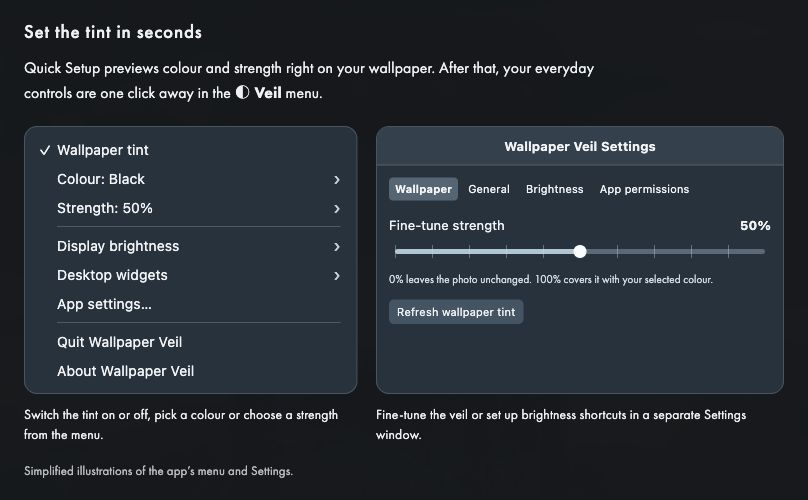

# Wallpaper Veil

[](https://github.com/Ry00ki/wallpaper-veil/actions/workflows/checks.yml)
[](https://github.com/Ry00ki/wallpaper-veil/releases/latest)

**Keep the wallpaper you love and make your desktop icons easier to read.**

Wallpaper Veil adds an adjustable tint behind your desktop icons. Your photos stay in rotation, and you control the tint from the macOS menu bar.

**[Download for macOS](https://github.com/Ry00ki/wallpaper-veil/releases/latest)** · [Portfolio showcase](https://www.vincent-ry00ki.com/wallpaper-veil)

Free and open source. Runs on macOS 13 or later on Apple silicon and Intel.

<p align="center">
  
</p>

## The same photograph, four ways

Pick a tint colour and strength while keeping your wallpaper and desktop icons in view. Save custom colours and switch the veil on or off whenever you like.



## One adjustment. Two displays.

Choose a source display and a follower. Adjust the source’s hardware brightness and the second display follows. The wallpaper tint has its own controls.



Optional keyboard shortcuts show Apple’s classic brightness indicator on the display being adjusted when the system service is available. Wallpaper Veil supplies its own indicator if that service is unavailable or reports an error. Brightness sync requires native macOS brightness control, which varies by monitor.

## Set the tint in seconds

Quick Setup previews colour and strength on your own wallpaper. Choose **Apply** to keep them or **Cancel** to restore the previous appearance. You can reopen Quick Setup from **App settings… → General**.

Look for **◐ Veil** in the menu bar. The compact menu puts Wallpaper tint, Colour and Strength at the top. **App settings…** opens a separate window for fine-tuning the tint, managing startup, recording brightness shortcuts and reviewing optional permissions.




*The photographs and simplified interface illustrations come from the portfolio showcase.*

<details>
<summary>Controls, shortcuts and permissions</summary>

- Tint strength ranges from 0% to 100%. The slider has marks every 10% plus 95%, 97% and 99%. Use the arrow keys for 1% steps or hold Option while dragging to bypass snapping.
- **Display brightness → Configure brightness shortcuts…** lets you record or clear the keyboard shortcuts. The default is Control–Option–Page Up or Page Down. Enable them from the Display brightness menu. They adjust the sync source or, with sync off, a supported active display. If your compact keyboard uses Fn for Page Up or Page Down, record the combination on that keyboard.
- **Desktop widgets → Use macOS defaults** turns off the app’s widget and clock automation, clears the three automation choices and returns widget visibility to the macOS default. Select a clock or Notification Center option, **Show now** or **Hide now** to use custom behaviour again.
- Showing widgets when you click the clock or open Notification Center requires Accessibility. Tint and brightness controls work without Accessibility or Input Monitoring. macOS may require approval in Login Items to launch the app at login.
- Brightness sync was tested on an Apple silicon Mac with two Apple displays. See [clock and Notification Center testing](https://github.com/Ry00ki/wallpaper-veil/issues/3) and [display and desktop lifecycle testing](https://github.com/Ry00ki/wallpaper-veil/issues/4) for ongoing compatibility work.

</details>

## Ready for your Mac

1. Download **`wallpaper-veil.zip`** from the [latest stable release](https://github.com/Ry00ki/wallpaper-veil/releases/latest).
2. Unzip it and move **Wallpaper Veil.app** into Applications or your personal `~/Applications` folder. Keep one installed copy.
3. Open the app and select **◐ Veil** in the menu bar.

The app bundles its engine and libraries. Run it directly from Applications. The checksum and JSON files on the release page are optional verification material. Early-access builds are available as **`wallpaper-veil-preview.zip`** in [Releases](https://github.com/Ry00ki/wallpaper-veil/releases).

Current builds are ad hoc signed. For first-launch approval, see [Apple’s Open Anyway instructions](https://support.apple.com/en-us/102445). [Developer ID signing and notarization](https://github.com/Ry00ki/wallpaper-veil/issues/7) are tracked on GitHub.

[Report a bug](https://github.com/Ry00ki/wallpaper-veil/issues/new?template=bug_report.yml) · [Buy me a coffee](https://ko-fi.com/ry00ki)

## Updating

Open **About Wallpaper Veil**. It checks published GitHub releases automatically and shows stable releases separately from early-access previews. Startup checks happen once per actual app launch, not on menu clicks or other interactions. Skip This Version persists across restarts; skipped updates remain manually installable in About, and a newer version can notify again. The Check for updates at startup checkbox disables automatic startup checks entirely. Choose **Download & Install** beside a newer version. Settings are kept; the old app is retained until the new app confirms normal startup, with recovery if it cannot start. No developer tools are required. Nothing is downloaded or installed merely by opening About.

Stable releases have tags such as `v1.0.0`; previews use `v1.0.1-preview.1` and GitHub's prerelease flag. Preview installation is an explicit choice, and the updater does not silently install an older/current version. The updater verifies the exact GitHub asset SHA-256, bound build receipt, safe package paths and nested code signatures. Current ad hoc builds trust this repository over HTTPS; independent publisher authentication via Developer ID/notarization remains [#7](https://github.com/Ry00ki/wallpaper-veil/issues/7).

Versions before 1.0 need one manual replacement to gain the installer: quit the old copy, replace its `.app` with the new one and reopen it. Manual replacement also remains available when the installed folder is not writable. Keep the previous release ZIP for recovery and avoid running copies from both Downloads and Applications. macOS may request renewed approval for optional desktop automation after an ad hoc update.

[Update verification and recovery](docs/updating.md) explains the native installation flow.

For release notifications, choose **Watch → Custom → Releases** on GitHub. See [GitHub notification settings](https://docs.github.com/en/subscriptions-and-notifications/get-started/configuring-notifications).

## Source and maintenance

The maintained checkout contains Wallpaper Veil's own code and an explicit engine integration policy:

```text
WallpaperVeil/
  core/       application behaviour and lifecycle
  native/     launcher, UI and macOS integration
  assets/     application identity
  ci/         build and package tooling
  tests/      product regression tests
engine/       pinned upstream policy and integration map
docs/         development and upstream-maintenance guides
```

The app still bundles an engine derived from Hammerspoon 1.1.1. The unused upstream working-tree folders are removed from current main, while their original history, licence and qualified engine-build source remain available. Builds fetch and verify the pinned upstream tag. This is a smaller maintained checkout, not a claim that the underlying native engine has been replaced.

- [Build and development](docs/development.md): Python/Xcode requirements and local acceptance tools, for contributors.
- [Architecture and ownership](docs/architecture.md): what is app-owned, adapted or retained.
- [Upstream integration and updates](docs/upstream-maintenance.md): original paths, transformations and review procedure.
- [CI and source-engine builds](WallpaperVeil/ci/README.md).

## Contributing and reporting problems

[Report a bug](https://github.com/Ry00ki/wallpaper-veil/issues/new?template=bug_report.yml), [suggest a feature](https://github.com/Ry00ki/wallpaper-veil/issues/new?template=feature_request.yml), or [open a pull request](https://github.com/Ry00ki/wallpaper-veil/compare). See [CONTRIBUTING.md](CONTRIBUTING.md) and [CHANGELOG.md](CHANGELOG.md). Include reproducible steps and a minimal, redacted error excerpt. Keep personal settings, display identifiers and complete private logs out of reports.

## Credits and licence

Wallpaper Veil builds on [Hammerspoon](https://github.com/Hammerspoon/hammerspoon), LuaSkin, Lua and the contributors to Hammerspoon and its dependencies. The source fork begins at Hammerspoon 1.1.1.

Wallpaper Veil's original code is licensed under the [MIT licence](LICENSE). Hammerspoon's MIT copyright and permission notice are preserved. Bundled third-party components retain their own licences and acknowledgements. See [third-party notices](THIRD_PARTY_NOTICES.md). Preserve them when modifying or distributing a build; see [CREDITS.md](CREDITS.md) and the built runtime's `Contents/Resources/Acknowledgements`.
