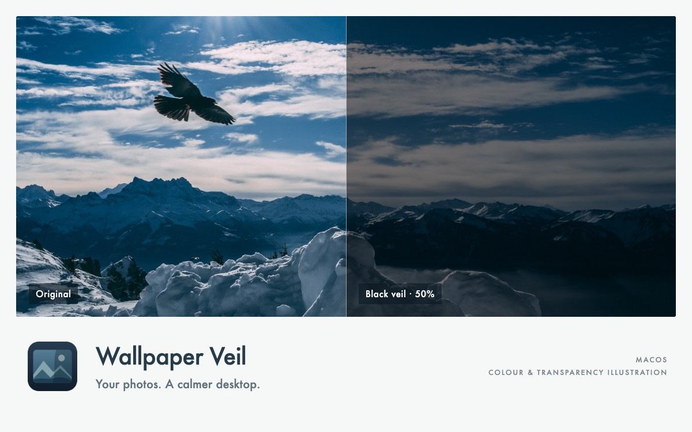
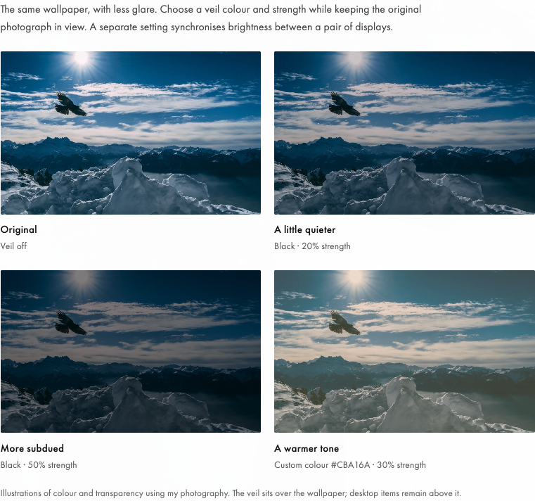
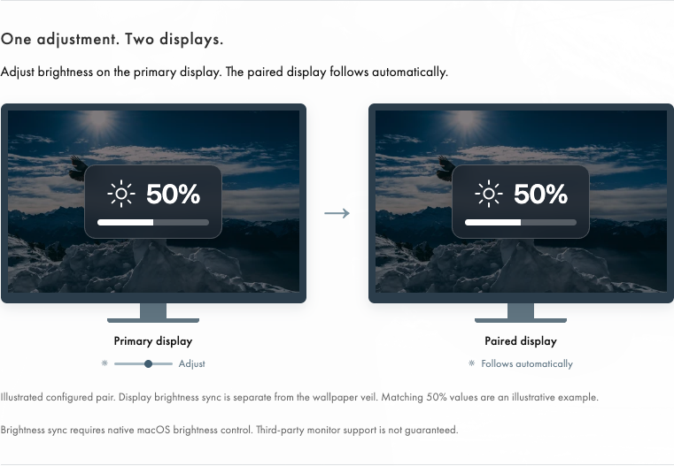
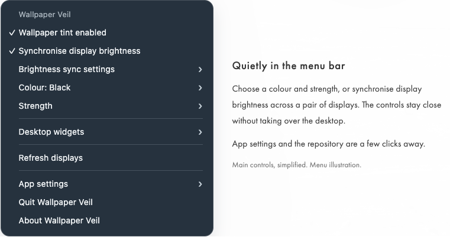

# Wallpaper Veil

[](https://github.com/Ry00ki/wallpaper-veil/actions/workflows/checks.yml)


Wallpaper Veil is a macOS menu-bar app that places a configurable colour tint above rotating photo wallpapers and below desktop icons. It also includes display-brightness sync and optional desktop-widget controls.

<p align="center">
  
</p>

## Install and use

Wallpaper Veil is distributed as **one self-contained `Wallpaper Veil.app`** for macOS 13 or later, on Apple Silicon and Intel Macs.

1. Download **`wallpaper-veil-preview.zip`** from [Releases](https://github.com/Ry00ki/wallpaper-veil/releases).
2. Expand the ZIP and drag **`Wallpaper Veil.app` into Applications**. Your personal `~/Applications` folder is also supported. Keep one installed copy.
3. Open the app and use **◐ Veil** in the menu bar.

That is the user installation. Python, Git, Xcode and a separate Hammerspoon installation are **not required to run the app**. Its native engine, Lua code and libraries travel inside the `.app`; writable app data lives in Application Support, with settings in its own macOS preferences domain. The release's checksum and JSON files are optional verification/provenance material, not extra items to install.

The current previews are ad hoc signed and not notarized. macOS may block a downloaded preview; see [Apple's documented Open Anyway process](https://support.apple.com/en-us/102445). Optional desktop-widget/clock automation requires macOS Accessibility approval; tint controls do not require that permission. Developer ID signing/notarization remains separate distribution work.

[Report a bug](https://github.com/Ry00ki/wallpaper-veil/issues/new?template=bug_report.yml) · [Portfolio overview](https://www.vincent-ry00ki.com/wallpaper-veil)

*The visuals below reuse the portfolio's photographs and simplified interface illustrations. They are not live application screenshots.*

## Features and current status

### Keep your wallpaper, choose its strength

Adjust tint colour and strength, save custom colours, and switch the veil on or off. The original photo stays in place and normal wallpaper rotation continues. Desktop icons and windows remain above the veil.

<details>
<summary>See colour and strength examples</summary>



</details>

### One adjustment, two displays

Choose a source display and a follower for hardware-brightness sync. When the source brightness changes, the paired display follows. This is separate from the wallpaper tint and strength controls.



Brightness sync requires native macOS brightness control. Third-party monitor support is not guaranteed; the preview does not yet have a supported-hardware matrix.

### Quietly in the menu bar

Look for **◐ Veil** in the menu bar; **○ Veil** indicates that the wallpaper tint is off. Open the menu for tint settings, display sync, optional desktop-widget and clock/Notification Center controls, and App settings. Quit and About Wallpaper Veil are available there too.

**Desktop widgets → Use macOS defaults** stops Wallpaper Veil's widget/clock automation and resets its widget-visibility preference to the macOS built-in default. It clears the three automation choices. Select a clock/Notification Center option, or Show now/Hide now, to opt back into custom behaviour; compatible automation choices can be combined.


<details>
<summary>See the simplified app menu</summary>



</details>

About Wallpaper Veil includes the repository and third-party notices, plus **Check for Updates** to compare the installed version with GitHub releases and open a newer release for manual updating.

The preview is for evaluation and development. Hardware-brightness changes can fail or be unsupported, and widget automation depends on macOS behavior and permissions. A local two-display test passed brightness synchronization, independent adjustment and restoration. Actual launch at login was verified after reboot on macOS 27.0.1. Sleep/wake and compatibility across different systems remain ongoing acceptance work. There is no published stable release or supported-hardware matrix yet.

## Updating

Quit Wallpaper Veil, replace the installed `.app` with the one from the new ZIP, then reopen it. Keep the previous release ZIP for recovery; avoid running copies from both Downloads and Applications.

About Wallpaper Veil shows the installed version/build/channel. **Check for Updates** compares public GitHub releases and opens a newer eligible release for a manual download. Preview builds can see preview and stable releases; stable builds see stable releases. It does not download or replace the app automatically.

For release notifications, choose **Watch → Custom → Releases** on GitHub. See [GitHub notification settings](https://docs.github.com/en/subscriptions-and-notifications/get-started/configuring-notifications).

## Source and maintenance

The maintained checkout contains Wallpaper Veil's own code and an explicit engine integration policy:

```text
WallpaperVeil/
  core/       application behaviour and lifecycle
  native/     launcher, UI and macOS integration
  assets/     application identity
  ci/         build and package tooling
  tests/      product regression tests
engine/       pinned upstream policy and integration map
docs/         development and upstream-maintenance guides
```

The app still bundles an engine derived from Hammerspoon 1.1.1. The unused upstream working-tree folders are removed from current main, while their original history, licence and qualified engine-build source remain available. Builds fetch and verify the pinned upstream tag. This is a smaller maintained checkout, not a claim that the underlying native engine has been replaced.

- [Build and development](docs/development.md): Python/Xcode requirements and local acceptance tools, for contributors.
- [Architecture and ownership](docs/architecture.md): what is app-owned, adapted or retained.
- [Upstream integration and updates](docs/upstream-maintenance.md): original paths, transformations and review procedure.
- [CI and source-engine builds](WallpaperVeil/ci/README.md).

## Contributing and reporting problems

[Report a bug](https://github.com/Ry00ki/wallpaper-veil/issues/new?template=bug_report.yml), [suggest a feature](https://github.com/Ry00ki/wallpaper-veil/issues/new?template=feature_request.yml), or [open a pull request](https://github.com/Ry00ki/wallpaper-veil/compare). See [CONTRIBUTING.md](CONTRIBUTING.md) and [CHANGELOG.md](CHANGELOG.md). Include reproducible steps and a minimal, redacted error excerpt. Keep personal settings, display identifiers and complete private logs out of reports.

## Credits and licence

Wallpaper Veil builds on [Hammerspoon](https://github.com/Hammerspoon/hammerspoon), LuaSkin, Lua and the contributors to Hammerspoon and its dependencies. The source fork begins at Hammerspoon 1.1.1.

Wallpaper Veil's original code is licensed under the [MIT licence](LICENSE). Hammerspoon's MIT copyright and permission notice are preserved. Bundled third-party components retain their own licences and acknowledgements. See [third-party notices](THIRD_PARTY_NOTICES.md). Preserve them when modifying or distributing a build; see [CREDITS.md](CREDITS.md) and the built runtime's `Contents/Resources/Acknowledgements`.
